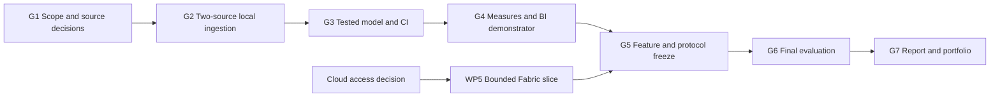

# Thesis development plan

This plan turns Li Yu’s [revised research proposal](Li_Yu_Thesis_Research_Plan.docx) into a sequenced backlog for a reliable heating/weather platform and a balanced analyst/engineer portfolio. It assumes strong SQL, Python and Power BI skills and the author-confirmed **50–55 hours per week until the end-of-2026 deadline**. Development status is proposed unless supported by a completed evidence record.

**Revised planning baseline:** 14 October 2026; status updated 16 October 2026. **Deadline:** end of 2026, author-confirmed; 31 December is the latest planning boundary until exact programme/review dates are recorded. **Capacity:** 50–55 hours/week to preserve the full analyst/engineer/Fabric scope. The 11 weeks from 15 October to 30 December allocate ten weeks at 51 hours and one at 50: **560 hours including 60 protected contingency hours**. Topic/RQs are author-confirmed approved. Academic workload sufficiency and exact review/submission dates remain pending.

This supersedes the earlier 20-hour/week, November–May, 28-week calendar. Actual author hours remain unrecorded; assisted implementation does not establish author learning hours or competency. Keep author review/reproduction within the package budget and reforecast using actual hours.

## Outcomes and current starting point

Deliver one local reference platform integrating Helen and FMI, an audited historical period, a tested dimensional model, five measures, three report pages, a statistical case study, an Excel audit and a two-page decision memo. Answer RQ1/RQ2 through E1–E7. Demonstrate one bounded Fabric deployment if access permits, then package two career case studies and a 5–7 minute demo.

**Current technical delivery:** WP2.1 foundation, WP2.2 source-value Helen intake and WP2.3 weather-point ingestion are complete. WP2.4 weather-only publication/recovery is verified; Helen and hourly/combined Gold integration remain pending their contracts/models. WP2.5 adds bounded local scheduling and an opt-in CI failure demonstration; hosted CI green/red/green evidence is now verified for baseline 9fb12dd. Selected-literature review is author-confirmed complete and local-only backup is author-selected. WP1/G1 remain open for source analytical/licence acceptance, academic metadata and applicable retention conditions in [the tracker](12-execution-tracker.md); final G5 freeze remains scheduled separately.

The author confirmed topic/RQ approval and Fabric access, but workspace/capacity/permissions still need verification. Source-dependent conversions wait for accepted physical semantics and licence conditions. Current evidence and next actions are in [the execution tracker](12-execution-tracker.md); development checks are not final E1–E7 results. Count October work once against its task, with actual author hours to be recorded.

## Work packages and budget

| Package | Planned hours | Result | Principal links |
| --- | ---: | --- | --- |
| WP1 Research scope and contracts | 60 | Literature, source decisions and final protocol | FR-01–FR-03, FR-16; G1/G5 |
| WP2 Ingestion and reliability | 100 | Two adapters, revisions, atomic publication, logging, tests and CI | FR-01–FR-05, FR-08, FR-11–FR-12; E1–E4 |
| WP3 SQL and data modelling | 70 | Migrations, dbt graph, Gold model and measured optimisation | FR-06–FR-07, FR-12; E1/E4/E5 |
| WP4 Analysis and BI | 90 | Five measures, three pages, statistics, Excel and memo | FR-07, FR-13–FR-14; E5–E7 |
| WP5 Fabric demonstration | 50 | One tested cloud slice or explicit access limitation | FR-15; conditional skill evidence |
| WP6 Final evaluation | 50 | Frozen E1–E7 results and interpretation | FR-16; G6 |
| WP7 Report and portfolio | 80 | Report, revisions, handover and two case studies | FR-16; G7 |
| C Contingency | 60 | Essential corrections, source problems and review delays | Logged use; no default feature allocation |
| **Total** | **560** | **500 planned work hours plus 60 contingency** | **10 × 51 + 1 × 50 hours** |

Estimates include learning needed for the task, implementation, relevant tests and its documentation. WP6 covers final controlled execution and synthesis, not all development testing. WP7 writing occurs throughout; it is not deferred to the final December week. Do not count one hour in two packages.

## Dependencies and completion gates

Cloud unavailability is an explicit alternate route into G5: retain local execution and record the unmet practical cloud outcome. It does not block RQ1/RQ2. Writing, literature work and competency evidence run across all gates.

| Gate | Target | Evidence required to pass |
| --- | --- | --- |
| G1 | 28 October 2026 | Topic/RQs/workload decisions; source-contract feasibility and unresolved blockers; common-period proposal; cloud route; initial literature/protocol and competency baseline |
| G2 | 4 November 2026 | Both sources produce repeatable local extracts, source provenance is retained and a same-revision replay is demonstrated on the accepted sample |
| G3 | 18 November 2026 | Initial tested SQL/dbt model, CI and source-to-measure slice; remaining optimisation/hardening tasks explicitly tracked |
| G4 | 2 December 2026 | Three report pages, all five measures reconciled on declared cases and draft analytical findings; final statistical sensitivity and polishing may continue within WP4 |
| G5 | 16 December 2026, W09 | Feature/protocol/input/environment freeze; conditional cloud evidence or fallback decision; final candidate is reproducible |
| G6 | 23 December 2026 | E1–E7 executed, failed criteria explained, reviewer/fallback evidence retained and results/discussion draft complete |
| G7 | By 31 December 2026 | Supervisor corrections, reproducibility review, final academic/reporting deliverables and portfolio handover; official submission date agreed separately |

Topic/RQ approval is author-confirmed; record its reference and academic workload/milestones when available. Source-dependent conversion/loading tasks also wait for their accepted contracts. A milestone is not passed merely because its target date has arrived.

## Revised working calendar and weekly capacity

The author chose increased weekly hours to preserve full scope: **50–55 hours/week**, confirmed on 14 October 2026. The blocks below run Thursday–Wednesday, starting the day after this update. W01–W10 allocate 51 hours each; W11 allocates 50, including protected reserve. Total allocation remains 560 hours. The earlier November–May calendar and two assumed non-working holiday weeks are superseded; this compressed plan does not assume those weeks are available as breaks.

| Week | Dates in 2026 | Allocation in hours | Main reviewable outcome |
| --- | --- | --- | --- |
| W01 | 15–21 Oct | WP1=30; WP2=15; WP7=6 | Author reviews delivered WP1/WP2.1 evidence; source/academic questions; weather ingestion and report introduction |
| W02 | 22–28 Oct | WP1=16; WP2=30; WP7=5 | G1 decision review; accepted source-specific contracts; typed adapters and quality accounting |
| W03 | 29 Oct–4 Nov | WP2=35; WP3=12; WP7=4 | Source replay/corrections/backfill, migrations and G2 review |
| W04 | 5–11 Nov | WP2=10; WP3=35; WP7=6 | CI/recovery foundations, SQL/dbt graph, dimensions and reporting views |
| W05 | 12–18 Nov | WP3=23; WP4=22; WP7=6 | Tested model/lineage/roles, optimisation, initial metric references and G3 |
| W06 | 19–25 Nov | WP4=43; WP7=8 | Five SQL/DAX measures, three Power BI pages, statistical/Excel/memo work and task pilot |
| W07 | 26 Nov–2 Dec | WP4=25; WP5=20; WP7=6 | G4 review, analytical diagnostics/sensitivity and Fabric access/vertical slice |
| W08 | 3–9 Dec | WP5=30; WP1=4; WP7=8; C=9 | Fabric operations/comparison/export; final source decisions and method/report review |
| W09 | 10–16 Dec | WP1=10; WP2=10; WP6=15; WP7=10; C=6 | G5 freeze, recovery hardening and controlled final engineering experiments |
| W10 | 17–23 Dec | WP6=35; WP7=10; C=6 | E1–E7 synthesis, author walkthrough/retests, results/discussion and G6 |
| W11 | 24–30 Dec | WP7=11; C=39 | Supervisor corrections, reproduction/release, two case studies/demo and G7 preparation |

Coordinate supervisor/programme review dates now: end-of-year holidays may move the practical review/submission deadline earlier. Do not assume staff or institutional services are available on 31 December. If required dates or workload cannot fit this envelope, reforecast with the supervisor rather than claiming completion. Fabric access/configuration must be checked by W07; keep the local main-evaluation route.

Contingency totals 60 hours and can move forward when source or review delays occur. Unused reserve does not justify adding features. At least fortnightly, compare remaining task estimates with actual author hours and confirmed capacity. Writing runs throughout, and final experiment failures/retests remain allocated rather than being omitted for the deadline.

## Detailed task backlog

Tasks below define the completion targets; current status is maintained in [the execution tracker](12-execution-tracker.md). Create a local issue/record when starting one, with actual hours, evidence links and the applicable requirement/experiment IDs. Proposed paths describe future artefacts unless the tracker links existing evidence.

### WP1 Research scope and contracts

| Task | Hours | Dependencies | Deliverable and completion check |
| --- | ---: | --- | --- |
| WP1.1 Scope and method | 12 | Research proposal | Record personas, RQ1/RQ2, AT-01–AT-05, scope and supervisor decisions; resolve academic blockers |
| WP1.2 Literature and design rationale | 18 | WP1.1, ongoing | Literature matrix with searches/inclusion reasons and 15–20 carefully selected scholarly sources as a planning target; connect evidence to at least three design decisions |
| WP1.3 Source contracts and period | 20 | Local file/profile and source documentation | Complete Helen unit/time/schema audit and FMI feasibility; create versioned manifests/contracts and freeze a justified common-period/station decision |
| WP1.4 Protocol and data management | 10 | WP1.1, accepted contracts; initial drafting early, final freeze at G5 | Freeze E1–E7, reference fixtures, thresholds, primary environment, reviewer/fallback arrangements and publication/retention rules |

### WP2 Ingestion and reliability

**WP2 delivery status, 16 October 2026:** foundation, weather ingestion and Helen source-value intake/quarantine are delivered. Weather release/recovery and executable-slice hosted CI green/red/green are verified for committed baseline 9fb12dd; local Helen code has 83 Windows/Linux tests and 44 database checks. [Helen/CI evidence](25-helen-source-intake.md) records actual runs. Integrated Helen/Gold publication remains conditional on analytical/model prerequisites. Future model checks belong to their implementation tasks. The WP2.5 budget stays 15 hours; actual author hours remain unrecorded.

| Task | Hours | Dependencies | Deliverable and completion check |
| --- | ---: | --- | --- |
| WP2.1 Foundation and run metadata | 20 | Topic approval, current setup | Create package/configuration, database client, run/snapshot records and safe fixtures; pin compatible dependencies; prove errors do not expose credentials |
| WP2.2 Helen ingestion | 20 | WP2.1; accepted Helen contract from WP1.3 | Implement explicit parsing, immutable source storage, row lineage and quarantine; valid/invalid/DST fixtures behave as specified |
| WP2.3 FMI ingestion | 20 | WP2.1; accepted FMI contract from WP1.3 | Implement bounded WFS requests, explicit station, response parsing and provenance; demonstrate repeated extraction and timeout handling |
| WP2.4 Replay correction and publication | 25 | WP2.2/WP2.3; initial database design | Implement revision precedence, business keys, checkpoints/backfills and accepted-release publication; same batch and corrected batch match expected results |
| WP2.5 CI scheduling and recovery | 15 | Foundation plus an executable slice; build checks early, harden by G5 | Add fixture-based CI, bounded scheduled/CLI execution and fault hooks; prove failed CI is visible and interruption leaves the previous release usable |

### WP3 SQL and data modelling

**WP3 delivery status, 16 October 2026:** seven migrations, source-only Helen loading and separate loader/reporter/transformer groups remain verified. The [WP3.2 graph](26-weather-dbt-models.md) now includes the [WP3.3 weather time/reporting slice](27-weather-time-model.md): nine private candidate models/36 SQL tests and 15 manufactured scenarios pass on Windows/Linux, alongside 94 offline tests and 44 database foundation controls. All 17,544 actual UTC hours and 731 Helsinki dates match independent arithmetic/calendar checks; 728 days are complete and three remain NULL with explicit missingness. Raw-point lineage and accepted source publication/checkpoint are preserved. Integrated Helen/station/system/Gold models, persistent logins and final E4 remain open. [WP3.4 operations](28-database-operations.md) now verifies a full 27-relation snapshot/restore, destination-only roles/ownership and five-repeat index lookup comparison on Windows/Linux; source data/publication remain unchanged. Next is WP4.1 metric reference SQL using the manufactured controls while actual paired-source acceptance stays open.

| Task | Hours | Dependencies | Deliverable and completion check |
| --- | ---: | --- | --- |
| WP3.1 Schema migrations and privileges | 18 | WP1.3; WP2.1 metadata design | Implement declared types/keys, migrations and loader/reporting roles; rebuild an empty database and reject reporting writes |
| WP3.2 dbt transformation graph | 22 | Typed sample from WP2; WP3.1 | Add staging/intermediate/Gold SQL, model documentation and key/relationship/custom tests; deliberate bad data fails visibly |
| WP3.3 Time model and reporting views | 15 | WP3.2; station/time decisions | Implement UTC hour spine, Helsinki labels, facts and aligned view; no fact multiplication or hidden weather gaps; provide lineage trace |
| WP3.4 Operations and optimisation | 15 | WP3.3; repeatable fixture | Implement backup/restore runbook and measure one query/index/materialisation change with identical results; preserve command and environment evidence |

### WP4 Analysis and BI

| Task | Hours | Dependencies | Deliverable and completion check |
| --- | ---: | --- | --- |
| WP4.1 Metric references and tests | 20 | WP3 slice; source-unit decision | Implement M1–M5 reference SQL, independent DAX and six filter cases each; retain small hand-calculated expected values |
| WP4.2 Semantic model and report | 20 | WP4.1 definitions; WP3 views | Build three Power BI pages, read-only parameterised connections and version-pinned refresh; verify filters, drill-through, units and accessibility |
| WP4.3 Statistical case study | 25 | Aligned Gold view; frozen missingness policy; chronological split recorded before exploratory modelling | Development-only EDA/model selection and learned preprocessing, calendar-only baseline, small explanatory model, protected holdout, diagnostics and justified uncertainty; finish sensitivity analysis before final E7 |
| WP4.4 Excel audit and decision memo | 15 | Initial WP4.1–WP4.3 outputs | Reconcile one monthly aggregate and one quality count in Excel; draft two pages with three supported findings, limitations and follow-up actions |
| WP4.5 Analytical task pilot | 10 | Three report pages and draft memo | Pilot AT-01–AT-05 and answer rubric, fix ambiguous wording/report issues, prepare reviewer materials and preserve feedback |

### WP5 Conditional Fabric demonstration

| Task | Hours | Dependencies | Deliverable and completion check |
| --- | ---: | --- | --- |
| WP5.1 Access and deployment design | 10 | D-011 access decision; G4 | Confirm workspace/capacity/sharing, safe connections and scoped resources; record cost assumptions and deployment steps |
| WP5.2 Cloud vertical slice | 20 | WP5.1; local contracts and reference outputs | One pipeline/Lakehouse and focused PySpark notebook; explicit schema and Delta updates; compare the same frozen sample with local output |
| WP5.3 Operations and access tests | 10 | WP5.2 | Demonstrate schedule, replay, failure recovery, permissions and refresh/capacity observations; record actual execution IDs |
| WP5.4 Export and handover | 10 | WP5.3 | Export notebook/pipeline/model definitions and evidence; document limitations and teardown/export procedure |

If access fails, record D-011 and an explicit local-only evaluation route. Do not spend 50 hours merely drawing a cloud design or claim cloud competence. Unused WP5 hours may be reassigned through the decision register while the total stays within 560; report the revised budget rather than double-counting savings and reserve.

### WP6 Final controlled evaluation

| Task | Hours | Dependencies | Deliverable and completion check |
| --- | ---: | --- | --- |
| WP6.1 Engineering experiments | 12 | G5 freeze | Execute E1–E4 locally and five-repeat performance scenarios with identical reset starting states; retain failures, raw counts, versions and recovery evidence |
| WP6.2 Metric and analysis experiments | 15 | G5; final WP4 sensitivity outputs | Execute E5/E7 from frozen code/input; verify at least 30 comparisons and regeneration of all reported findings |
| WP6.3 Reviewer study or fallback | 13 | WP4.5; consent/arrangements | Execute E6 with 2–3 reviewers if available; preserve original/retest scores, or clearly label author-only walkthrough |
| WP6.4 Synthesis and validity | 10 | WP6.1–WP6.3 | Requirement–result traceability, failed-criterion discussion, RQ answers and draft design lessons; complete G6 review |

### WP7 Academic report and portfolio

| Task | Hours | Dependencies | Deliverable and completion check |
| --- | ---: | --- | --- |
| WP7.1 Report throughout development | 30 | Starts W01; update with evidence | Draft introduction/literature/method/design and later implementation/results in the required thesis format |
| WP7.2 Results and supervisor revisions | 24 | Initial drafts and G6 evidence | Complete discussion/limitations/RQ answers; address recorded supervisor comments and required academic checks |
| WP7.3 Career case studies and demo | 16 | Working artefact and verified results | Analyst and engineer case studies, architecture/model visuals, screenshots and a 5–7 minute demo; no fabricated outcome claims |
| WP7.4 Release and reproduction handover | 10 | Final code/report, E4 and review | Clean-checkout check, publication/licence review, final evidence index and competency sign-off; record G7 status |

## Delivery workflow and definition of done

1. Select a task whose prerequisites are met; split into small issues without changing the package total.
2. Link its FR/NFR, M/E and competency IDs. Define the expected output before implementation.
3. Implement a thin source-to-test-to-report slice; retain actual hours, decisions and relevant failures.
4. Run tests appropriate to the change. Update contracts, runbook and documentation with exact working commands.
5. Review code and evidence. Label self-review honestly if no peer is available.
6. Mark done only when the stated completion check passes and evidence is linked; record deviations and retests.

A successful task includes reproducible output, documented assumptions, relevant tests and a short explanation of limitations. Source data and secrets require deliberate handling before any external publication. Creating this plan does not create GitHub issues, deploy Fabric resources or publish the repository.

## First actions

These actions are part of WP1/WP2, not extra hours:

- [x] Author confirmed supervisor approval of the revised topic and RQs on 14 October 2026.
- [ ] Record approval details, confirm academic workload and replace assumed dates with agreed milestones when available.
- [ ] Resolve the Helen `dh_MWh` physical quantity/boundary and current-edition licence; the author confirms interval-end labels (`10:00` covers `[09:00,10:00)`); explicit parsing, publisher-declared UTC labels and both proposed hourly key ranges are already audited.
- [x] Declare the FMI weather feasibility baseline and audit its full 2024–2025 Helsinki calendar window; retain missingness evidence and strict six-sample coverage rules.
- [x] Record author-confirmed Helen interval-end labels: `10:00` covers `[09:00,10:00)`; canonical start is one elapsed UTC hour earlier. Selected-period labels audited under contract v0.3.
- [ ] Accept final paired Helen/FMI time alignment, source revisions and period before analytical loading; select the station-sensitivity comparison before heat modelling.
- [x] First FMI sample and nine-case representative matrix acquired and inspected; final station/aggregation/full-period acceptance remains open.
- [ ] Record dataset licences and a common-period decision; complete baseline competency evidence.
- [x] Create the scope/method record, initial literature matrix/search log (now 20 DOI-verified candidates and 15 core selections), six design-rationale links and data-management draft; complete critical reading and pending decisions before marking WP1 done.
- [x] Complete WP2.1 package/module CLI, configuration and acquisition-to-ledger integration; 44 offline tests, nine database checks and full retained-input replay verified.
- [x] Complete WP2.3 under the accepted weather-only contract: typed source-resolution load/replay, repeated bounded live extraction and timeout/failure checks; 52 offline tests and 16 database checks pass.
- [x] Deliver the weather-only WP2.4 release/revision/backfill/checkpoint and interruption-recovery path; 61 offline tests and 25 database checks pass. Integrate Helen and the complete Gold graph after their prerequisites.
- [x] Deliver WP2.5 bounded local scheduling/recovery and opt-in CI failure preparation; 72 Windows/Linux tests, 28 database checks and current workflow lint pass. Two real replay ticks preserve the release/checkpoint.
- [x] Record hosted CI green/red/recovery URLs and commit 9fb12dd, completing WP2.5’s executable-slice criterion; new local Helen code awaits its own publication. Add future model checks with those models.
- [x] Deliver WP2.2 local Helen source values, lineage/quarantine and real load/replay; 91,767 rows, zero source quarantine; suite 83/44 on Windows/Linux.
- [x] Deliver WP3.1’s accepted-weather schema/permission slice: five migrations, real restricted-login enforcement, 76 offline tests/39 database controls on Windows/Linux; track full integrated schemas/logins separately.
- [x] Deliver WP3.2 weather-first dbt candidates: five models/22 tests, nine Windows/Linux controls and 17,544 independent hourly comparisons. Reporter/accepted publication remain unchanged; integrated model scope stays open.
- [x] Deliver WP3.3 weather UTC/Helsinki dimensions and hourly/daily candidate reports: nine models/36 tests, 15 Windows/Linux scenarios, 17,544 independent hour labels and 731 dates/728 complete days. Partial/DST cases and lineage pass; integrated Gold remains gated.
- [x] Deliver WP3.4 for the current local prototype: full snapshot/restore comparison, reconstructed restricted roles/ownership and measured index lookup with identical results. Archives/plans/code retained; 94 offline tests pass on Windows/Linux. Final E4/full-load/incremental experiments remain later.
- [x] Record end-of-2026 deadline, increased 50–55-hour weekly capacity and full-scope 11-week calendar. Exact academic review/submission details remain pending.

## Scope and risk control

Review actual hours and forecast at least every two weeks. Track reserve used, reason and remaining hours. First remove unallocated forecasting/additional sources; then reduce conditional cloud scope. Preserve final evaluation and academic writing. If required academic workload exceeds available capacity, extend the calendar with the supervisor rather than claim 560 hours is sufficient by definition.

Every change after G5 must identify affected contracts, metrics, experiments and evidence; rerun the affected final checks. Use [the decision register](04-decisions-and-questions.md) for approvals/changes and [the competency log](10-competency-evidence.md) for career evidence.
