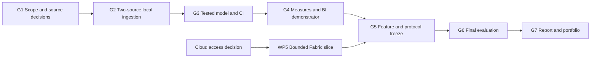

# Thesis development plan

This plan turns Li Yu’s [revised research proposal](Li_Yu_Thesis_Research_Plan.docx) into a sequenced backlog for a reliable heating/weather platform and a balanced analyst/engineer portfolio. It assumes strong SQL, Python and Power BI skills and **20 hours per week**. Development status is proposed unless supported by a completed evidence record.

**Baseline:** 14 October 2026. **Implementation window:** November 2026–May 2027. **Capacity:** 28 active weeks, 560 hours, including 60 protected contingency hours. The official topic, workload and Wihi dates need supervisor agreement; this is not a replacement for those decisions.

## Outcomes and current starting point

Deliver one local reference platform integrating Helen and FMI, an audited historical period, a tested dimensional model, five measures, three report pages, a statistical case study, an Excel audit and a two-page decision memo. Answer RQ1/RQ2 through E1–E7. Demonstrate one bounded Fabric deployment if access permits, then package two career case studies and a 5–7 minute demo.

Already completed preparation: local Python/Pandas environment, PostgreSQL/Docker setup checks, Git initialisation, a generic Helen CSV profile and the revised research plan. These do not mean source semantics, production ingestion, CI, models, reports or final experiments are complete. October preparation is recorded separately from the future 560-hour implementation budget.

**Execution started on 14 October 2026 at the author's request:** explicit Helen parsing audit, bounded FMI acquisition/inspection, representative historical samples, operational metadata migration/database client and synthetic tests are implemented. The author confirmed supervisor approval of the revised topic and RQs. See [the source audit](11-source-audit.md) and [execution tracker](12-execution-tracker.md). WP1.3 and WP2.1 are in progress; source acceptance and remaining academic decisions still apply. Record October work against its task when reporting actual workload; do not add a second budget for the same work.

## Work packages and budget

| Package | Planned hours | Result | Principal links |
| --- | ---: | --- | --- |
| WP1 Research scope and contracts | 60 | Literature, source decisions and final protocol | FR-01–FR-03, FR-16; G1/G5 |
| WP2 Ingestion and reliability | 100 | Two adapters, revisions, atomic publication, logging, tests and CI | FR-01–FR-05, FR-08, FR-11–FR-12; E1–E4 |
| WP3 SQL and data modelling | 70 | Migrations, dbt graph, Gold model and measured optimisation | FR-06–FR-07, FR-12; E1/E4/E5 |
| WP4 Analysis and BI | 90 | Five measures, three pages, statistics, Excel and memo | FR-07, FR-13–FR-14; E5–E7 |
| WP5 Fabric demonstration | 50 | One tested cloud slice or explicit access limitation | FR-15; conditional skill evidence |
| WP6 Final evaluation | 50 | Frozen E1–E7 results and interpretation | FR-16; G6 |
| WP7 Report and portfolio | 80 | Report, revisions, handover and two case studies | FR-16; G7 |
| C Contingency | 60 | Essential corrections, source problems and review delays | Logged use; no default feature allocation |
| **Total** | **560** | **500 planned work hours plus 60 contingency** | **28 × 20 hours** |

Estimates include learning needed for the task, implementation, relevant tests and its documentation. WP6 covers final controlled execution and synthesis, not all development testing. WP7 writing occurs throughout; it is not deferred to May. Do not count one hour in two packages.

## Dependencies and completion gates

Cloud unavailability is an explicit alternate route into G5: retain local execution and record the unmet practical cloud outcome. It does not block RQ1/RQ2. Writing, literature work and competency evidence run across all gates.

| Gate | Target | Evidence required to pass |
| --- | --- | --- |
| G1 | November 2026 | Topic/RQs/workload decisions; source-contract feasibility and unresolved blockers; common-period proposal; cloud route; initial literature/protocol and competency baseline |
| G2 | December 2026 | Both sources produce repeatable local extracts, source provenance is retained and a same-revision replay is demonstrated on the accepted sample |
| G3 | January 2027 | Initial tested SQL/dbt model, CI and source-to-measure slice; remaining optimisation/hardening tasks explicitly tracked |
| G4 | February 2027 | Three report pages, all five measures reconciled on declared cases and draft analytical findings; final statistical sensitivity and polishing may continue within WP4 |
| G5 | March 2027, W20 boundary | Feature/protocol/input/environment freeze; conditional cloud evidence or fallback decision; final candidate is reproducible |
| G6 | April 2027 | E1–E7 executed, failed criteria explained, reviewer/fallback evidence retained and results/discussion draft complete |
| G7 | May 2027 | Supervisor corrections, reproducibility review, final academic/reporting deliverables and portfolio handover; official submission date agreed separately |

Topic approval must precede formal thesis implementation. Foundation work in the early schedule depends on that approval arriving; adjust dates if it does not. Source-dependent conversion/loading tasks also wait for their accepted contracts. A milestone is not passed merely because its target date has arrived.

## Working calendar and weekly capacity

The dates below are scheduling assumptions: start Monday 2 November 2026, reserve **21 December 2026–3 January 2027** as two non-working calendar weeks, then finish W28 on 30 May 2027. These breaks can move without changing the 28 active-week capacity. Actual workload and official dates take precedence.

Each allocation sums to 20 hours. WP numbers refer to the budgets above; C is protected reserve. The W20 boundary crosses into April, and W24 crosses into May; complete the relevant gate within its agreed month or record a revised date.

| Week | Dates | Allocation in hours | Main reviewable outcome |
| --- | --- | --- | --- |
| W01 | 2–8 Nov 2026 | WP1=16; WP7=4 | Scope/RQs, evidence map, initial literature and supervisor questions |
| W02 | 9–15 Nov 2026 | WP1=12; WP2=6; WP7=2 | Source audit progress; package/configuration and safe-fixture design |
| W03 | 16–22 Nov 2026 | WP1=10; WP2=8; WP7=2 | Explicit parser/time/unit contracts and first typed fixture |
| W04 | 23–29 Nov 2026 | WP1=8; WP2=10; WP7=2 | G1 decisions, sample manifests and run-ledger foundation |
| W05 | 30 Nov–6 Dec 2026 | WP2=18; WP7=2 | Helen adapter and row/quality accounting |
| W06 | 7–13 Dec 2026 | WP2=18; WP7=2 | FMI adapter, verified station and query-chunk evidence |
| W07 | 14–20 Dec 2026 | WP2=18; WP7=2 | Both-source sample, provenance and replay; G2 review |
| W08 | 4–10 Jan 2027 | WP2=10; WP3=8; WP7=2 | Corrections/backfill, initial migrations and key tests |
| W09 | 11–17 Jan 2027 | WP2=2; WP3=16; WP7=2 | CI checks and dbt staging/intermediate models |
| W10 | 18–24 Jan 2027 | WP3=18; WP7=2 | Hour/date dimensions, Gold facts and aligned weather view |
| W11 | 25–31 Jan 2027 | WP3=18; WP7=2 | Model tests, lineage and source-to-measure demonstrator; G3 |
| W12 | 1–7 Feb 2027 | WP3=10; WP4=8; WP7=2 | Query optimisation evidence and independent KPI references |
| W13 | 8–14 Feb 2027 | WP4=18; WP7=2 | Semantic model, DAX/Power Query and metric comparison cases |
| W14 | 15–21 Feb 2027 | WP4=18; WP7=2 | Three report pages and reproducible exploratory analysis |
| W15 | 22–28 Feb 2027 | WP4=18; WP7=2 | Reconciled M1–M5, initial model/findings and G4 review |
| W16 | 1–7 Mar 2027 | WP4=18; WP7=2 | Statistical diagnostics, Excel audit, memo and task pilot |
| W17 | 8–14 Mar 2027 | WP5=18; WP7=2 | Fabric workspace/pipeline and declared access configuration |
| W18 | 15–21 Mar 2027 | WP5=18; WP7=2 | Delta/PySpark transformations and sample result comparison |
| W19 | 22–28 Mar 2027 | WP5=14; WP1=4; WP7=2 | Cloud recovery/export evidence and final source/protocol decisions |
| W20 | 29 Mar–4 Apr 2027 | WP1=10; WP2=10 | Fault/recovery hardening; feature/input/protocol freeze at G5 |
| W21 | 5–11 Apr 2027 | WP4=10; WP6=8; WP7=2 | Final analytical sensitivity checks and start frozen experiments |
| W22 | 12–18 Apr 2027 | WP6=16; WP7=4 | Engineering experiments, performance and metric reconciliation |
| W23 | 19–25 Apr 2027 | WP6=16; WP7=4 | Reviewer tasks or fallback, reproducibility and result interpretation |
| W24 | 26 Apr–2 May 2027 | WP6=10; WP7=10 | G6 evidence review and complete results/discussion draft |
| W25 | 3–9 May 2027 | WP7=10; C=10 | Supervisor corrections and reproducibility handover |
| W26 | 10–16 May 2027 | WP7=10; C=10 | Final report, two portfolio case studies and demo |
| W27 | 17–23 May 2027 | C=20 | Protected correction/review capacity and G7 check |
| W28 | 24–30 May 2027 | C=20 | Remaining corrections and agreed submission/publication process |

Unused reserve remains available; it is not an obligation to add features. If a problem arises earlier, move reserve forward and update the calendar and completion forecast. The typical 8-hour engineering / 6-hour analytics / 4-hour research / 2-hour review split is a guide; this package-based calendar is the auditable capacity allocation.

## Detailed task backlog

Tasks below define the completion targets; current status is maintained in [the execution tracker](12-execution-tracker.md). Create a local issue/record when starting one, with actual hours, evidence links and the applicable requirement/experiment IDs. Proposed paths describe future artefacts unless the tracker links existing evidence.

### WP1 Research scope and contracts

| Task | Hours | Dependencies | Deliverable and completion check |
| --- | ---: | --- | --- |
| WP1.1 Scope and method | 12 | Research proposal | Record personas, RQ1/RQ2, AT-01–AT-05, scope and supervisor decisions; resolve academic blockers |
| WP1.2 Literature and design rationale | 18 | WP1.1, ongoing | Literature matrix with searches/inclusion reasons and 15–20 carefully selected scholarly sources as a planning target; connect evidence to at least three design decisions |
| WP1.3 Source contracts and period | 20 | Local file/profile and source documentation | Complete Helen unit/time/schema audit and FMI feasibility; create versioned manifests/contracts and freeze a justified common-period/station decision |
| WP1.4 Protocol and data management | 10 | WP1.1, accepted contracts; initial drafting early, final freeze at G5 | Freeze E1–E7, reference fixtures, thresholds, primary environment, reviewer/fallback arrangements and publication/retention rules |

### WP2 Ingestion and reliability

| Task | Hours | Dependencies | Deliverable and completion check |
| --- | ---: | --- | --- |
| WP2.1 Foundation and run metadata | 20 | Topic approval, current setup | Create package/configuration, database client, run/snapshot records and safe fixtures; pin compatible dependencies; prove errors do not expose credentials |
| WP2.2 Helen ingestion | 20 | WP2.1; accepted Helen contract from WP1.3 | Implement explicit parsing, immutable source storage, row lineage and quarantine; valid/invalid/DST fixtures behave as specified |
| WP2.3 FMI ingestion | 20 | WP2.1; accepted FMI contract from WP1.3 | Implement bounded WFS requests, explicit station, response parsing and provenance; demonstrate repeated extraction and timeout handling |
| WP2.4 Replay correction and publication | 25 | WP2.2/WP2.3; initial database design | Implement revision precedence, business keys, checkpoints/backfills and accepted-release publication; same batch and corrected batch match expected results |
| WP2.5 CI scheduling and recovery | 15 | Foundation plus an executable slice; build checks early, harden by G5 | Add fixture-based CI, bounded scheduled/CLI execution and fault hooks; prove failed CI is visible and interruption leaves the previous release usable |

### WP3 SQL and data modelling

| Task | Hours | Dependencies | Deliverable and completion check |
| --- | ---: | --- | --- |
| WP3.1 Schema migrations and privileges | 18 | WP1.3; WP2.1 metadata design | Implement declared types/keys, migrations and loader/reporting roles; rebuild an empty database and reject reporting writes |
| WP3.2 dbt transformation graph | 22 | Typed sample from WP2; WP3.1 | Add staging/intermediate/Gold SQL, model documentation and key/relationship/custom tests; deliberate bad data fails visibly |
| WP3.3 Time model and reporting views | 15 | WP3.2; station/time decisions | Implement UTC hour spine, Helsinki labels, facts and aligned view; no fact multiplication or hidden weather gaps; provide lineage trace |
| WP3.4 Operations and optimisation | 15 | WP3.3; repeatable fixture | Implement backup/restore runbook and measure one query/index/materialisation change with identical results; preserve command and environment evidence |

### WP4 Analysis and BI

| Task | Hours | Dependencies | Deliverable and completion check |
| --- | ---: | --- | --- |
| WP4.1 Metric references and tests | 20 | WP3 slice; source-unit decision | Implement M1–M5 reference SQL, independent DAX and six filter cases each; retain small hand-calculated expected values |
| WP4.2 Semantic model and report | 20 | WP4.1 definitions; WP3 views | Build three Power BI pages, read-only parameterised connections and version-pinned refresh; verify filters, drill-through, units and accessibility |
| WP4.3 Statistical case study | 25 | Aligned Gold view; frozen missingness policy; chronological split recorded before exploratory modelling | Development-only EDA/model selection and learned preprocessing, calendar-only baseline, small explanatory model, protected holdout, diagnostics and justified uncertainty; finish sensitivity analysis before final E7 |
| WP4.4 Excel audit and decision memo | 15 | Initial WP4.1–WP4.3 outputs | Reconcile one monthly aggregate and one quality count in Excel; draft two pages with three supported findings, limitations and follow-up actions |
| WP4.5 Analytical task pilot | 10 | Three report pages and draft memo | Pilot AT-01–AT-05 and answer rubric, fix ambiguous wording/report issues, prepare reviewer materials and preserve feedback |

### WP5 Conditional Fabric demonstration

| Task | Hours | Dependencies | Deliverable and completion check |
| --- | ---: | --- | --- |
| WP5.1 Access and deployment design | 10 | D-011 access decision; G4 | Confirm workspace/capacity/sharing, safe connections and scoped resources; record cost assumptions and deployment steps |
| WP5.2 Cloud vertical slice | 20 | WP5.1; local contracts and reference outputs | One pipeline/Lakehouse and focused PySpark notebook; explicit schema and Delta updates; compare the same frozen sample with local output |
| WP5.3 Operations and access tests | 10 | WP5.2 | Demonstrate schedule, replay, failure recovery, permissions and refresh/capacity observations; record actual execution IDs |
| WP5.4 Export and handover | 10 | WP5.3 | Export notebook/pipeline/model definitions and evidence; document limitations and teardown/export procedure |

If access fails, record D-011 and an explicit local-only evaluation route. Do not spend 50 hours merely drawing a cloud design or claim cloud competence. Unused WP5 hours may be reassigned through the decision register while the total stays within 560; report the revised budget rather than double-counting savings and reserve.

### WP6 Final controlled evaluation

| Task | Hours | Dependencies | Deliverable and completion check |
| --- | ---: | --- | --- |
| WP6.1 Engineering experiments | 12 | G5 freeze | Execute E1–E4 locally and five-repeat performance scenarios with identical reset starting states; retain failures, raw counts, versions and recovery evidence |
| WP6.2 Metric and analysis experiments | 15 | G5; final WP4 sensitivity outputs | Execute E5/E7 from frozen code/input; verify at least 30 comparisons and regeneration of all reported findings |
| WP6.3 Reviewer study or fallback | 13 | WP4.5; consent/arrangements | Execute E6 with 2–3 reviewers if available; preserve original/retest scores, or clearly label author-only walkthrough |
| WP6.4 Synthesis and validity | 10 | WP6.1–WP6.3 | Requirement–result traceability, failed-criterion discussion, RQ answers and draft design lessons; complete G6 review |

### WP7 Academic report and portfolio

| Task | Hours | Dependencies | Deliverable and completion check |
| --- | ---: | --- | --- |
| WP7.1 Report throughout development | 30 | Starts W01; update with evidence | Draft introduction/literature/method/design and later implementation/results in the required thesis format |
| WP7.2 Results and supervisor revisions | 24 | Initial drafts and G6 evidence | Complete discussion/limitations/RQ answers; address recorded supervisor comments and required academic checks |
| WP7.3 Career case studies and demo | 16 | Working artefact and verified results | Analyst and engineer case studies, architecture/model visuals, screenshots and a 5–7 minute demo; no fabricated outcome claims |
| WP7.4 Release and reproduction handover | 10 | Final code/report, E4 and review | Clean-checkout check, publication/licence review, final evidence index and competency sign-off; record G7 status |

## Delivery workflow and definition of done

1. Select a task whose prerequisites are met; split into small issues without changing the package total.
2. Link its FR/NFR, M/E and competency IDs. Define the expected output before implementation.
3. Implement a thin source-to-test-to-report slice; retain actual hours, decisions and relevant failures.
4. Run tests appropriate to the change. Update contracts, runbook and documentation with exact working commands.
5. Review code and evidence. Label self-review honestly if no peer is available.
6. Mark done only when the stated completion check passes and evidence is linked; record deviations and retests.

A successful task includes reproducible output, documented assumptions, relevant tests and a short explanation of limitations. Source data and secrets require deliberate handling before any external publication. Creating this plan does not create GitHub issues, deploy Fabric resources or publish the repository.

## First actions

These actions are part of WP1/WP2, not extra hours:

- [x] Author confirmed supervisor approval of the revised topic and RQs on 14 October 2026.
- [ ] Record approval details, confirm academic workload and replace assumed dates with agreed milestones when available.
- [ ] Resolve the Helen `dh_MWh` quantity and interval/time convention; then audit explicit parsing and expected hourly keys.
- [ ] Accept the final FMI station/aggregation contract and verify full common-period coverage before bulk analytical use.
- [x] First FMI sample and nine-case representative matrix acquired and inspected; final station/aggregation/full-period acceptance remains open.
- [ ] Record dataset licences and a common-period decision; complete baseline competency evidence.
- [ ] Complete WP2.1 packaging and configuration/evidence integration; its database client, operational ledger, migration and initial safe checks are now implemented.

## Scope and risk control

Review actual hours and forecast at least every two weeks. Track reserve used, reason and remaining hours. First remove unallocated forecasting/additional sources; then reduce conditional cloud scope. Preserve final evaluation and academic writing. If required academic workload exceeds available capacity, extend the calendar with the supervisor rather than claim 560 hours is sufficient by definition.

Every change after G5 must identify affected contracts, metrics, experiments and evidence; rerun the affected final checks. Use [the decision register](04-decisions-and-questions.md) for approvals/changes and [the competency log](10-competency-evidence.md) for career evidence.
