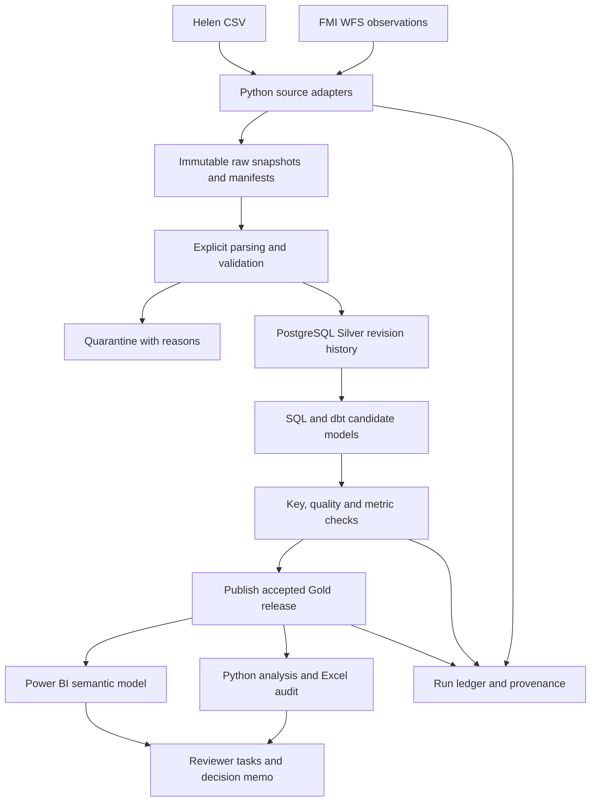

# Local platform architecture and Fabric demonstration

**Status:** proposed platform design, with source-audit helpers and operational database foundation implemented on 14 October 2026. The generic profiler, Compose setup, Helen/FMI feasibility tools, database client and first operational migration exist. Source-to-ledger integration, analytical ingestion and models remain planned. See [the source audit](11-source-audit.md), [the data dictionary](05-data-dictionary.md) for grains and [the task backlog](07-development-plan.md) for implementation ownership.

## Logical flow

Layers describe responsibilities. Local Bronze is immutable files/responses plus metadata; Silver/Gold use PostgreSQL. The local prototype does not need a distributed engine for the observed data volume.

## Component boundaries and planned layout

| Proposed location | Responsibility | Completion task |
| --- | --- | --- |
| `ingestion/` | Source adapters, manifests, bounded requests, parser contracts and CLI | WP2.1–WP2.3 |
| `config/` | Versioned non-secret settings; environment-specific values kept separate | WP2.1 |
| `sql/migrations/` | Operational tables, constraints, roles and database migrations | WP3.1 |
| `models/` | One dbt project with staging/intermediate/Gold models and tests | WP3.2–WP3.3 |
| `analytics/` | Reproducible notebooks/functions, statistical configuration and memo inputs | WP4.3–WP4.4 |
| `powerbi/` | Report/model artefacts, readable DAX/Power Query, metric comparisons and refresh instructions | WP4.1–WP4.2 |
| `tests/` | Safe fixtures, unit/integration checks, fault injection and expected outputs | WP2–WP6 |
| `fabric/` | Bounded deployment exports and cloud/local comparison evidence | WP5 |
| `.github/workflows/` | Fixture-based CI; no mandatory live-source dependency | WP2.5 |
| `experiments/` | Versioned experiment definitions and selected publication-safe evidence | WP6 |
| `docs/` | Contracts, decisions, model/metric definitions, runbook and handover | All packages |

Create these paths as their tasks begin. A single application package/entry point should orchestrate acquisition, validation, modelling and publication; its exact command is added to the setup guide only after implemented and tested.

## Snapshot and revision lifecycle

1. Acquire a source file/response to a temporary location and compute its content hash; retain the acquisition URL/parameters and time separately.
2. Preserve an immutable content snapshot. Repeated acquisition of the same content references the existing snapshot and records the attempt.
3. Validate the declared contract before transformation. Unknown schema stops the batch; rejected rows keep their original locator and reason.
4. Load typed revision history with explicit source keys. A corrected snapshot must not silently erase the earlier version.
5. Resolve the active revision using a documented publisher-version/precedence rule. Do not assume a later download proves a newer observation revision.
6. Transform a candidate Gold release and validate its keys, lineage, coverage and metrics.
7. Publish only an accepted candidate; record the source set, configuration and content identity. Advance the completed checkpoint after successful publication.

For an unchanged source revision/configuration, a replay may write a new execution record but must leave published keyed values unchanged. A correction/backfill updates only intended business keys and must match a clean rebuild from the same final revisions.

## Atomic publication and report consistency

Proposed local pattern: build candidate tables/rows under a new `release_id`; validate all required models; atomically update the accepted-release reference in one PostgreSQL transaction. Failed candidates never become visible through reporting views. Retain the prior accepted release for comparison/recovery.

dbt model materialisation alone is not assumed to make the entire model graph atomic. The runner owns candidate validation and publication. Test interruption before publication and ensure checkpoints do not advance incorrectly.

Pin one accepted `release_id` for the whole Power BI refresh and analytical run. Separate report queries must not accidentally mix releases if another run publishes mid-refresh. Validate the pinning mechanism or prevent publication during refresh until it is implemented. Fact/dimension/source references must be consistent within the selected release.

## Orchestration and operations

The initial local workflow uses one CLI and a simple documented scheduler, chosen in WP2.5. It needs bounded retries, visible dependency order, nonzero exit status on failure and safe reruns. Additional orchestration platforms are stretch work, not dependencies of the local core.

Use separate loader and reporting accounts; the current setup superuser is not the final reporting identity. Store secrets outside Git. Log source/version identifiers and safe error context rather than credentials or unnecessary payloads. Apply migrations before pipeline execution and test a fresh database build.

Back up the database and required raw manifests; restore into a separate test database. Verify keys, values and audit records against the backup snapshot. Document the recovery command sequence and expected status before testing any restore into a working environment.

CI should start an isolated test database, apply migrations, load synthetic fixtures, run Python/data/model checks and fail on bad expected outcomes. Live FMI access is a separate integration check; third-party availability must not make ordinary unit tests unreliable.

## Conditional Fabric slice

| Local responsibility | Bounded Fabric equivalent | Required evidence |
| --- | --- | --- |
| CLI/scheduler | One Data Factory pipeline with explicit dependencies | Successful scheduled run and failure/retry behaviour |
| Immutable snapshots | Lakehouse raw files and manifests | Same input hashes and provenance |
| Typed transformations | One focused notebook with explicit PySpark schema and Delta updates | Agreed contracts, correction/replay and sample equality |
| Gold/reporting outputs | Analytical Delta tables and a compatible Power BI model | M1–M5 results for the same frozen sample; declared refresh path |
| Local roles/run logs | Scoped workspace/data access and operational observations | Access test, run IDs, capacity observation and export plan |

The core contracts and expected results are shared; platform-specific SQL/Spark implementations must be compared, not assumed identical. Use a single Lakehouse deployment rather than adding a separate full warehouse stack. Keep WP5 within 50 hours and record any remaining difference or unsupported behaviour.

Confirm capacity/sharing rights before deployment. If using a trial, check current terms close to activation and export evidence before access expires. If access is unavailable, RQ1/RQ2 proceed locally and practical Fabric outcomes remain incomplete. D-010 selects the local reference for principal E1–E7 evaluation; confirm its exact configuration at G5. A change to Fabric requires an equivalent versioned protocol. Do not combine local and cloud timings into one benchmark.

## Release checklist

- [ ] Source contracts, licences and frozen period recorded.
- [ ] E1/E2 demonstrate key correctness, lineage, revisions and backfill.
- [ ] E3 demonstrates failed candidates cannot publish partial Gold.
- [ ] E4 proves clean reproduction, least-privilege reporting and separate-database restore.
- [ ] E5 reconciles five metrics and refresh uses a consistent release.
- [ ] Configuration, code, schema/model versions and evidence paths identify the release.
- [ ] Runbook explains diagnosis, rerun, backup, restore and limitations.

Architecture choices are recorded under D-004, D-008 and D-014–D-015. Validate the proposed mechanism in implementation; a diagram is not evidence that the required behaviour exists.
