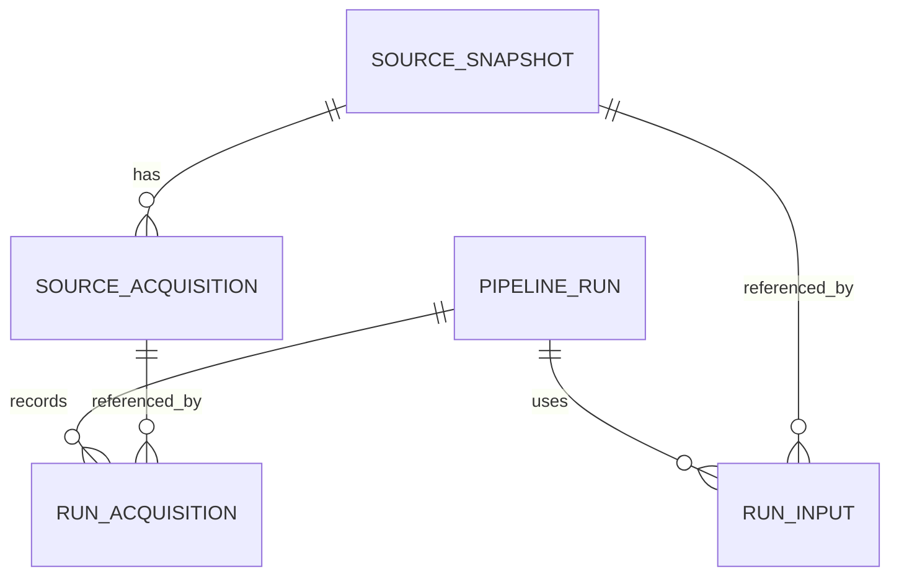

# WP2.1 operational provenance and CLI

**Delivered:** 14 October 2026. **Status:** WP2.1 foundation implemented and locally verified. This records acquisition evidence in PostgreSQL; analytical loading, Silver/Gold models and E1–E7 execution follow in their own tasks. Existing Helen semantic/licence conditions are unchanged.

This is the **WP2.1 delivery baseline**. The subsequent [WP2.3 weather implementation](21-weather-ingestion.md) adds a third migration and typed Silver observations; current test/database counts are recorded there. The nine checks, 44 tests and 106-acquisition totals below describe the earlier foundation delivery, rather than the current complete prototype.

## Entry point and configuration

Run from the repository root with the prepared virtual environment:

```powershell
.venv\Scripts\python.exe -m ingestion --help
.venv\Scripts\python.exe -m ingestion database check
.venv\Scripts\python.exe -m ingestion database migrate
.venv\Scripts\python.exe -m ingestion manifests inspect --source HELEN --manifest experiments/source-audit/helen-current-resource-acquisition.json
.venv\Scripts\python.exe -m ingestion manifests record --source HELEN --manifest experiments/source-audit/helen-current-resource-acquisition.json
```

`inspect` runs offline without connecting to PostgreSQL. `record` requires the migrated local database and records a new run even for unchanged evidence. Both verify the retained manifest and raw bytes. No download is performed. The `database check` command creates and removes its own UUID-named isolated test database; it needs database-creation privilege. Legacy audit/foundation scripts remain available.

[foundation.json](../config/foundation.json) maps explicit source identities to raw directories and source contracts. `--configuration` selects a versioned project-local configuration; `--raw-directory` permits a project-local raw directory override, such as the preselected station-sensitivity inputs. Configuration identity includes the foundation-file hash, selected source, actual raw directory and current source-contract hash. Paths outside the project, raw paths outside `data/raw/` and manifests outside `experiments/source-audit/` are rejected. Credentials still come from the ignored `.env`/environment; they are absent from configuration and command arguments.

For one retained FMI acquisition:

```powershell
$fmiManifest = Get-ChildItem -LiteralPath experiments/source-audit/fmi-period-manifests -File | Select-Object -First 1
.venv\Scripts\python.exe -m ingestion manifests inspect --source FMI --manifest $fmiManifest.FullName
.venv\Scripts\python.exe -m ingestion manifests record --source FMI --manifest $fmiManifest.FullName
```

Repeat `--manifest` to register multiple inputs atomically. To register the completed 105-chunk period in PowerShell:

```powershell
$recordArguments = @('-m', 'ingestion', 'manifests', 'record', '--source', 'FMI')
Get-ChildItem -LiteralPath experiments/source-audit/fmi-period-manifests -File -Filter '*.json' | Sort-Object Name | ForEach-Object {
    $recordArguments += @('--manifest', $_.FullName)
}
& .venv\Scripts\python.exe @recordArguments
```

Acquisition time is taken from the retained manifest, while registration/run time is recorded by PostgreSQL. Importing an older manifest today does not invent a new acquisition. FMI imports require the supported explicit-station temperature query, matching public request URL/parameters, successful acquisition, matching raw size/hash and a fresh XML inspection equal to the saved inspection. Returned NaNs remain inspected missing values; duplicates fail. Helen imports must match the verified current snapshot and download URL in its contract; they are recorded as `acquired`, without granting physical-semantic or redistribution approval.

## Ledger grains and replay



| Object | Identity / responsibility |
| --- | --- |
| `ops.source_snapshot` | Source ID plus raw-content SHA-256; repeated content reuses one snapshot |
| `ops.source_acquisition` | Snapshot plus exact manifest-byte SHA-256; retains retrieval time, request metadata, byte size and manifest locator |
| `ops.pipeline_run` | UUID per execution, configuration hash, code/environment identity, status and counts |
| `ops.run_input` | Run × snapshot, without duplicate links |
| `ops.run_acquisition` | Run × acquisition; composite foreign keys require the acquisition and run input to reference the same snapshot |

The additive [002 migration](../sql/migrations/002_acquisition_provenance.sql) preserves the original ledger. SQL migration bytes are fixed to LF through `.gitattributes`, keeping checksums stable across Windows/Linux checkouts. An unchanged acquisition reuses its snapshot/acquisition but creates a distinct run and links. A later acquisition manifest with a different retrieval time can reference the same raw content while retaining a separate acquisition. Neither case determines publisher revision precedence.

Each recorded run captures Python/Psycopg versions, Git HEAD, working-tree state and SHA-256 hashes of the `ingestion/` Python files and migrations. The current worktree is uncommitted; the baseline commit alone does not describe its implementation. Preserve the accompanying file hashes and commit the reviewed release before final reproduction/evaluation.

## Failure and evidence boundaries

Input verification, snapshot/acquisition registration, links and successful completion occur within one transaction. Invalid batches roll back those writes and retain a separate failed run with `ACQUISITION_REGISTRATION_FAILED`. No failed-run input links are retained. Initial configuration/connection failures occur before a run is created. Errors return a nonzero CLI status and omit raw exception text that might expose connection secrets or SQL parameters.

PostgreSQL is the authoritative ledger. Successful-run JSON reports are written afterwards to ignored `experiments/source-audit/ledger-runs/<run_id>.json`. If that local write fails, the committed database run remains successful while the CLI returns a failure; inspect the ledger before retrying. A retry safely reuses acquisition identities and creates a new execution. This foundation is not a database backup or an atomic Gold publication mechanism.

## Verified delivery

- **44 offline tests** pass on Windows and disposable Linux Python 3.13.7, with compatible pinned dependencies.
- **Nine isolated PostgreSQL checks** pass: original six ledger/migration checks plus acquisition/retrieval identity, failed-batch atomicity/durable status and run/acquisition/snapshot link integrity. The initial link-integrity fixture accidentally hit an existing primary key; it was corrected to use a distinct acquisition, then the complete check passed.
- The configured local database contains **106 snapshots and 106 acquisitions**: 105 FMI weekly chunks and one current Helen file. **Three successful runs** and **211 run/acquisition links** reflect Helen registration, full FMI registration and full FMI replay. Replay adds no snapshots/acquisitions. No analytical observations are loaded.
- Actual runs: Helen `5c561abf-eb0d-490b-8089-2e42bb023198`; FMI `31d7530e-262b-4919-8882-6f15718ce0f1`; FMI replay `0df77d5d-a95f-438a-8cbd-973c5d9fb486`. Detailed ignored verification: `experiments/source-audit/provenance-ledger-verification.json`.

The [CI workflow](../.github/workflows/ci.yml) now checks the module entry point and expanded offline suite, and invokes the nine-check foundation through that entry point. Hosted CI execution remains pending. WP2.1's technical completion does not pass G1/G2 or demonstrate the author's independent competency. The next implementation prerequisite is a selected, accepted source contract for typed ingestion; Helen conversion remains conditional. See [the tracker](12-execution-tracker.md) and [source contracts](16-source-contracts.md).
