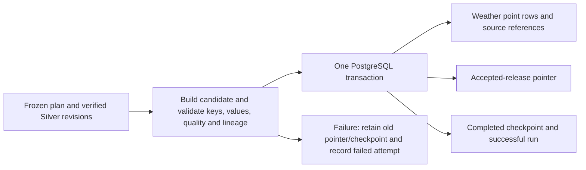

# WP2.4 weather revisions, publication and recovery

**Delivered:** 14 October 2026. **Status:** weather source-point path implemented and verified; integrated Helen/hourly/BI Gold publication remains pending its source/model prerequisites. This release framework extends [typed FMI ingestion](21-weather-ingestion.md). Preparatory tests are not final E1–E7 results, and no Fabric publication is implied.

## Commands and frozen source policy

```powershell
.venv\Scripts\python.exe -m ingestion database migrate
.venv\Scripts\python.exe -m ingestion release publish --plan config/weather-release-plan.json
.venv\Scripts\python.exe -m ingestion release status --plan config/weather-release-plan.json
```

The [versioned plan](../config/weather-release-plan.json) selects exactly the 105 audited Kaisaniemi snapshots for the Helsinki 2024–2025 weather window. It excludes the separate one-hour extraction snapshot. It declares stream/station, UTC bounds, parameter/unit, policy, layer reasons and raw-content hashes. The source set is explicit; download time is never used to resolve revisions.

| Layer | Rules |
| --- | --- |
| First `base` | Frozen reference snapshots; conflicting values for the same key within this layer fail |
| Later `correction` / `backfill` | Explicit precedence reason required; present keys overlay earlier values, while omissions preserve them |
| Equal overlapping values | One key retained with deterministic lineage from sorted source hashes; all selected snapshots retained in release metadata |
| Absent expected key | NULL value and `source_absent` quality on the independent ten-minute grid; no invented sensor observation or zero fill |

Create a new plan file/version when changing source layers; do not silently mutate the frozen reference. A stream cannot switch station, shrink its accepted window or implicitly delete previously returned values. Changes to accepted keys require an explicit overlay layer. A source NaN is a returned missing value, distinct from an absent key. Neither precedence mode proves publisher chronology; it is a declared project selection policy with reasons and retained prior revisions.

Each selected Silver snapshot is rechecked against its raw-content checksum and freshly parsed source rows. Unknown/incompatible snapshots, altered values, duplicate/conflicting keys or off-grid times stop publication. Source acquisition and typed loading remain separate commands; publication performs no network request.

## Transaction and checkpoint boundary



[Migration 004](../sql/migrations/004_weather_publication.sql) creates:

| Object | Grain / purpose |
| --- | --- |
| `ops.release` | One accepted or failed candidate; plan/hash, build run, parent release, content hash and counts |
| `ops.release_source` | Release × selected snapshot × declared layer |
| `publication.weather_point` | Release × expected ten-minute key; station/parameter, value/quality and chosen source snapshot/point index |
| `ops.accepted_release` | One accepted release pointer per weather stream |
| `ops.publication_checkpoint` | Same stream/release plus completed exclusive end and plan hash; advances only on successful commit |
| `publication.current_weather_point` | Current accepted source-point view; includes stream and release IDs |

The publisher shares the weather-ingestion advisory lock to coordinate source reads with the loader, and serializes publication pointer updates. Candidate rows/source links, accepted pointer, checkpoint and successful run status commit together. A separate reader sees the old accepted release while the new transaction is uncommitted, including after the writer's pointer update. This follows [PostgreSQL's transaction visibility rules](https://www.postgresql.org/docs/17/transaction-iso.html) and was checked directly with two database connections.

The checkpoint means that the declared window has been processed with complete quality accounting; it does not mean every measurement is finite. New data/lineage are retained under a new release ID. An unchanged plan/content replay verifies existing rows and reuses the accepted release ID without advancing the checkpoint timestamp. Content hashes canonicalize decimals and timestamps to UTC, independent of the session's display timezone; lineage is checked separately.

**Pin a release ID once for a whole refresh or analysis.** Query `publication.weather_point` with that ID across subsequent queries. The current view can legitimately change between separate autocommit queries after a successful new publication. Prior release rows remain retained by the application; least-privilege roles and database restore are later WP3/E4 work.

## Failure, restart and stale-candidate protection

For a failed attempt after its input problem is corrected:

```powershell
.venv\Scripts\python.exe -m ingestion release resume --plan config/weather-release-plan.json
```

Resume requires the same plan hash and a failure against the current accepted parent. It rebuilds the complete candidate from retained input snapshots; it does not pretend that rolled-back candidate rows are a completed checkpoint. If the accepted parent changed, review the new state and plan instead of resuming an obsolete candidate. `--expected-release <uuid>` can additionally require a specific parent during publish/resume; replace the placeholder with the reviewed UUID.

Run context is recorded before candidate construction: candidate/parent IDs and the owning PostgreSQL backend PID/start time. Expected failures or cooperative interruption retain `WEATHER_PUBLICATION_FAILED` with a safe stage/error type. A killed process can leave its run `running` while PostgreSQL rolls back the candidate transaction. Resume checks that the owning backend is gone, records `WEATHER_PUBLICATION_ABANDONED`, then rebuilds against the unchanged parent. A still-live backend or stale parent is rejected. Do not use resume to take over an active publisher.

SQL/connection errors that prevent writing failure metadata can require a later restart inspection; they do not make an uncommitted pointer/checkpoint visible. Successful JSON summaries are written after database commit under ignored `experiments/source-audit/publication-runs/`; PostgreSQL remains authoritative if a later file write fails. Earlier code versions are preserved under ignored code snapshots, keeping historical run hashes attributable.

## Actual local release and checks

Accepted stream: **`fmi-kaisaniemi-reference`**. Release: **`f327b833-7b99-453f-b376-d1f82a0fe7d9`**.

- **105,264 expected keys**; 105,248 observed finite values, 16 source NaNs, zero source-absent keys; 105 selected snapshots. The extra live-query frame is excluded.
- Completed exclusive end: **`2025-12-31T22:00:00Z`**, matching the declared Helsinki reporting-period boundary.
- Content SHA-256: `ca80125fb35a1c2a288041523326469c6c7c87808279110936bfad0447093008`.
- Original publish run: `c22ca7be-a44f-48fd-a623-922c83c11e8d`; replays `56558fb0-3887-44b9-bef9-6e60916b4f41` and `07f31354-cca0-44d8-a361-605d4b14f520` reuse the same release. The latter verifies the UTC-portable code. Current ledger totals: ten successful pipeline runs, one accepted weather release, 105 release/source links and 105,264 published weather keys. There are no failed candidates in the working database; faults were tested in isolated databases.
- **61 offline tests** pass on Windows/Linux and **25 isolated PostgreSQL checks** pass. Publication controls cover independent expected-key states, replay, conflict rejection, explicit corrections/old release retention, both publication fault boundaries with a separate reader, backfill/resume versus clean rebuild, stale-parent rejection, a terminated test process and Helsinki-session UTC portability.
- Latest local evidence snapshot verifies **361 files, 56,979,584 input bytes and three sample restores**, preserving earlier backups. It remains on C:; database restore/independent storage are not established.

Detailed private verification: `experiments/source-audit/publication-verification.json` and run summaries. The existing CI command automatically includes these offline and isolated database checks; hosted CI is still pending. SQL/dbt hourly models, heating acceptance/ingestion, the combined accepted Gold graph, permissions, scheduler and final frozen evaluation keep their own completion criteria. See [the development plan](07-development-plan.md) and [tracker](12-execution-tracker.md).

## Subsequent WP2.5 status

On 15 October 2026, two real bounded scheduler ticks replayed this same release without changing its content or original checkpoint timestamp. The current suite is 72 offline tests and 28 database checks; the ledger now has 12 successful runs. A newer 379-file local backup/three restores is verified, still on C:. The counts above describe the original WP2.4 delivery. [Scheduling and CI operations](23-scheduling-and-ci.md) records the new run IDs, diagnosis procedure and pending hosted CI evidence.

## Subsequent WP3.1 status

On 16 October 2026, [accepted-weather reporting views and loader/reporter groups](24-database-permissions.md) were verified. The current suite is 76 offline tests and 39 database checks on Windows/Linux. The loader-role replay keeps the original release/checkpoint; the working ledger has 13 successful runs and two retained failed startup attempts from the corrected session-visibility issue. Earlier counts above describe their dated delivery. Latest local evidence backup: 415 files/three sample restores, still on C:. Hosted CI, persistent application/BI logins and full Gold/E4 remain pending.

## Subsequent Helen and hosted CI delivery

[Helen source intake](25-helen-source-intake.md), delivered 16 October 2026, adds migration 006 and explicit loader-only SELECT/INSERT on two intake tables. The current suite is 83 offline tests/44 DB checks on Windows/Linux. Actual intake/replay retains 91,767 source records without changing weather publication. Hosted CI green/red/green is verified for 9fb12dd (76/39 baseline); local Helen changes await their own publication. The author confirms selected-literature review and consumption interpretation, and chooses local-only backup with shared-drive risk acceptance. Earlier counts above describe their dated delivery.
