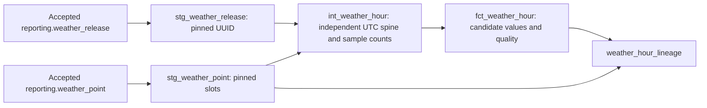

# WP3.2 weather-first dbt graph

**Verified:** 16 October 2026. **Status:** this runbook preserves the five-model/22-test WP3.2 delivery baseline. [WP3.3 now extends it to nine models/36 tests](27-weather-time-model.md) with weather time dimensions and hourly/daily reporting; integrated Helen/station/system/Gold remain later source/model work. This supports FR-06/07/08/11/12, NFR-01/02/03/06/09/12 and SK-10/12/13. The WP3.2 estimate remains 22 hours; actual author hours and competency demonstration remain to record. This is development verification, not final E1–E7 execution or Gold acceptance.

## Install and run

Run from the repository folder. The optional modelling requirements include the existing application requirements without changing their pins:

```powershell
.venv\Scripts\python.exe -m pip install -r requirements-models.txt
.venv\Scripts\python.exe -m pip check
.venv\Scripts\python.exe -m ingestion database migrate
.venv\Scripts\python.exe -m ingestion database model-role
.venv\Scripts\python.exe -m ingestion models check
.venv\Scripts\python.exe -m ingestion models build --release-id f327b833-7b99-453f-b376-d1f82a0fe7d9
```

Use the setup coordinator connection, with `ENERGY_DB_ROLE` unset, for these administrative/ledger commands. [requirements-models.txt](../requirements-models.txt) selects dbt Core **1.12.6** and dbt-postgres **1.11.0**; [model constraints](../requirements-models-lock.txt) pin the resolved dependency set alongside the existing application constraints. Installation and `pip check` pass on Windows/Linux Python 3.13.7. Direct offline/application work can continue using `requirements-dev.txt` alone.

The build requires an explicit UUID already present in the accepted weather ledger. It never silently follows a changing current pointer, downloads source data or processes Helen energy. A new invocation gets a new run UUID and private artifact directory. The run summary, model/dependency file hashes, installed dbt versions, source release/content identity, invocation ID and 105 selected input-snapshot links are retained for the latest actual build.

The committed [profiles.yml](../models/profiles.yml) contains environment expressions only. The coordinator passes the password privately as `DBT_ENV_SECRET_PASSWORD`, which dbt masks; console retention also redacts that value. No password appears in subprocess arguments. Profiles/targets/logs stay project-local, with generated artifacts under ignored `experiments/source-audit/`; anonymous usage reporting is disabled. The invocation has a five-minute process timeout, two threads, a two-minute server statement timeout and five-second lock timeout. The coordinator serializes builds of this shared candidate graph.

Connection/role configuration follows the [official dbt PostgreSQL profile documentation](https://docs.getdbt.com/docs/local/connect-data-platform/postgres-setup); password masking uses [dbt's secret environment-variable convention](https://docs.getdbt.com/reference/dbt-jinja-functions/env_var).

## Graph, grains and policy



| Model | Grain / materialisation | Meaning |
| --- | --- | --- |
| `stg_weather_release` | One selected accepted release / view | Station/parameter, declared bounds and input hashes; exactly one row required |
| `stg_weather_point` | Release × expected ten-minute timestamp / view | Selected values, explicit source NaN/absence and snapshot/point lineage |
| `int_weather_hour` | Release × station × parameter × UTC hour / table | Hour spine generated from declared bounds independently of surviving measurements, left-aligned to grouped point counts |
| `fct_weather_hour` | Same UTC hour / view | Candidate mean, finite/NaN/absent/published-slot counts, complete flag and `is_imputed=false` |
| `weather_hour_lineage` | Selected published slot × its UTC hour / view | Preserves every slot and chosen snapshot/point index, including distinct missing states |

These five objects live only in `dbt_weather`. A complete hour requires exactly six published slots and six finite observed values. Its temperature is the arithmetic mean of the six sampled one-minute temperatures, not a claim of a continuous hour-average measurement. Incomplete hours remain in the independent spine with NULL temperature. Source NaNs, publisher-declared absent slots and missing published rows are separate counts: processing loss must fail tests, not be relabelled as source absence. No fill, zero substitution or omission of incomplete hours occurs.

UTC keys preserve spring/fall elapsed hours. Helsinki date/hour dimensions and strict reporting-day eligibility are now delivered in [WP3.3](27-weather-time-model.md). Multiple revisions are never averaged together because every model filters the same explicit accepted UUID. Sampling/selection rules remain those of the existing source contract.

## Permission and publication boundary

[Migration 007](../sql/migrations/007_weather_model_build.sql) creates the private candidate schema and revokes PUBLIC access. The explicit `database model-role` command provisions non-login `energy_transformer`, separately from loader/reporter groups. It receives SELECT on the two accepted-weather reporting views and USAGE/CREATE in `dbt_weather`; it has no schema/database creation, temporary-table, role-management or raw/operational-table access. It owns its generated models, which is necessary to replace them. Reprovisioning permits ownership only within that candidate schema, rejects unexpected role attributes/memberships/ownership and clears stale source column/table grants.

The coordinator uses the existing administrator connection for run metadata; child dbt connections switch to the transformer role. Real temporary non-superuser logins prove the same restricted DDL/read boundary in integration checks. No persistent model/BI login credentials were created. The reporter cannot read `dbt_weather`.

**A successful dbt build does not publish Gold.** dbt commits models individually, so a failed build can leave a partially refreshed candidate graph. Accepted weather source-point rows, pointer/checkpoint and current reporting views remain independent. Use candidates only with a successful run's pinned release/evidence. Integrated atomic Gold acceptance/reporting grants need their later model/publication contract; this task deliberately does not connect reporting to the candidate graph.

## Tests and actual evidence

The original WP3.2 project has **22 dbt data tests**: key/null/relationship/quality controls plus five SQL tests for selected release bounds, point integrity, hourly coverage accounting, expected hours and complete lineage equality. No external dbt package is needed.

The original isolated `models check` command ran **nine controls** using manufactured reporting inputs and a restricted transformer login in a newly created UUID database. It tests hand-calculated mean `mean(0,2,4,6,8,10)=5`, separate source-NaN/absent states, 23-hour spring and 25-hour fall days, explicit release selection, full lineage, duplicate-key failure, missing-published-slot failure, repaired green recovery, docs/catalog generation and role limits/reprovisioning. It preserves green/red/recovery `run_results.json` files and removes only its own test database/roles. These controls are grouped into nine result records rather than nine individual dbt tests.

| Verification | Result |
| --- | --- |
| Offline tests | **87 pass**, Windows and Linux |
| Existing operational database checks | **44 pass**, Windows and Linux; seven migrations rebuild/replay cleanly |
| Additional model controls | **9 pass**, Windows and Linux, including intended bad-data failures and recovery |
| Actual dbt graph | **5 models / 22 tests pass**, docs manifest/catalog generated |
| Independent real-data comparison | **17,544 hourly comparisons** against Python Decimal arithmetic, tolerance `0.000000000001`; 17,539 complete and five incomplete hours; 16 source NaNs |
| Lineage | **105,264 slots**, preserving selected snapshot/point identities |
| Actual selected source | `f327b833-7b99-453f-b376-d1f82a0fe7d9`; source hash `ca80125fb35a1c2a288041523326469c6c7c87808279110936bfad0447093008` |
| Latest actual run | **`bbc7a069-562f-4620-94d3-1ca6d505d48b`**, with 105 input-snapshot links and durable model/source identity |
| Earlier successful build | `da9a7f1f-0fb3-4ccc-9056-321f502ddc89`; exact initial code archived before the expanded dependency/input identity |
| Publication boundary | Accepted weather UUID/content/original checkpoint unchanged; reporter candidate read denied |
| WP3.2 ledger | 17 successful pipeline runs and two retained earlier role-switch startup failures; no running attempts; WP3.3 adds a successful model run |

Private evidence: `experiments/source-audit/model-runs/<run-id>/summary.json`, `target/run_results.json`, generated `manifest.json`, documentation `catalog.json`/HTML, `model-checks/`, `linux-model-checks/` and `weather-model-verification.json`. Initial model-build code and earlier intake code are retained under private code snapshots. All source/secret/generated artifacts remain ignored.

The [CI workflow](../.github/workflows/ci.yml) adds a separate PostgreSQL-backed weather-model job that installs the optional requirements and runs the synthetic controls (now 15 after WP3.3), including deliberate failures whose detection is asserted before the job passes. Current actionlint 1.7.12 validation passes, and the full job command passes in disposable Linux. Hosted green/red/green evidence for baseline 9fb12dd remains historical; the new dbt/calendar job and supporting code are now published and [hosted CI passes on c25c87f](https://github.com/yuliplanora-hue/ThesisProject/actions/runs/38896004389). The original delivery counts above remain historical.

[WP3.3 weather time/reporting](27-weather-time-model.md) is now delivered. [WP3.4 database backup/restore and measured optimisation](28-database-operations.md) are now verified; the validated complete model graph still needs its accepted Gold publication contract. Helen interpretation/licence and paired analytical acceptance remain explicit source conditions. See [the development plan](07-development-plan.md) and [execution tracker](12-execution-tracker.md).

WP3.2 local evidence snapshot: **1,316 files, 87,986,004 input bytes and three sample restores** at `backup/evidence-20261016T110931Z-4a65bcde0e02417ba189e596f37790df/manifest.json`. The [DMP](15-data-management-plan.md) records the latest WP3.3 snapshot. Previous snapshots remain preserved; the author-selected shared-C: storage risk is unchanged and no database restore is claimed.
